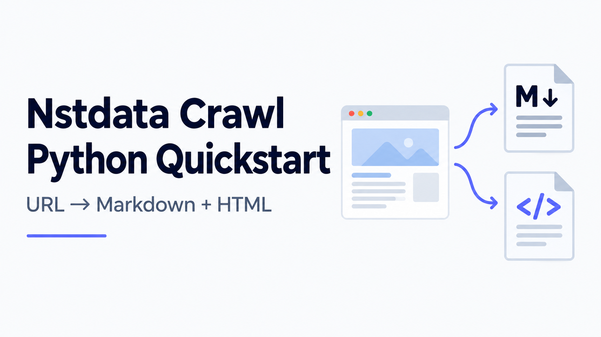

# Nstdata Crawl Python Quickstart

Export authorized webpage content to Markdown and HTML with a small Python CLI.



## Introduction

[Nstdata](https://www.nstdata.io/?utm_source=github&utm_medium=referral&utm_campaign=nstdata_repo_test&utm_content=repository-readme)
provides Crawl for retrieving webpage content. This example submits a scrape task,
polls until completion, downloads the requested content and exports a run manifest.

**Markdown and HTML passed a live acceptance test** on the Nstdata scraping page.
The repository also includes a deterministic offline demo. Raw Data support is
experimental; it is excluded from the default live example.

## Features

- Markdown and HTML file export, individually or together.
- Up to 10 explicitly supplied URLs per run, processed sequentially.
- A manifest that reports success, failure and availability of each requested format.
- One submission per page, with at most 20 result queries and 2 seconds between pending queries.
- Download of inline or SDK reference-backed content.
- Separate checks for task completion and target HTTP errors.
- New output directories per run; existing output directories are refused.

This is a single-page API example. It does not recursively discover an entire site.

## Quick Start

Use Python 3.10 or newer. Local acceptance used Python 3.13.
Clone this repository, then run the offline demo without an API key:

```zsh
PROMPT='nstdata % '; clear
git clone https://github.com/Alexxa-yang/nstdata_repo_test.git
cd nstdata_repo_test
PYTHONPATH=src python3 -m nstdata_quickstart --mode mock
```

Mock mode returns a fixed fixture and makes no network requests.
The output directory contains `page-001.md`, `page-001.html` and `manifest.json`.

## Live Example

Install the optional SDK dependency in a local virtual environment:

```zsh
PROMPT='nstdata % '; clear
python3 -m venv .venv
source .venv/bin/activate
python -m pip install '.[live]'
PYTHONPATH=src python examples/playground_scrape.py
```

The example targets the Nstdata scraping page with `ProxyDto(country="ANY")`,
a 30,000 ms task timeout, and Markdown and HTML outputs. It prompts for a hidden
API key if `NSTDATA_API_TOKEN` is not already set. Enter the key only at that prompt.
The key is not written to a file. Live requests can consume product credit.

For your own permitted target, set `NSTDATA_API_TOKEN` locally and use the CLI's
`--mode live --authorized --url` options. `.env.example` lists the variable;
`.env` files are not automatically loaded.

### Request and result handling

The adapter calls `submit_scrape_task`, receives a task ID, polls
`get_scrape_task_result`, then reads content with `get_markdown` and `get_html`.
A submission response alone is not a completed scrape.

The SDK selects its own API endpoint. The tested SDK source uses `api.nstproxy.com`;
the example does not override it. Socket connection/read timeouts are 10/75 seconds.
These and the task timeout do not impose a hard wall-clock deadline on a batch.
If polling expires, check task history before submitting again: the remote task may
still be running. The client never automatically resubmits a pending task.

## Usage

Select one format:

```zsh
PROMPT='nstdata % '; clear
PYTHONPATH=src python examples/playground_scrape.py --format markdown
```

Repeat `--url` with the CLI to provide up to 10 targets. Query strings are omitted
from manifest URLs; page content may still contain sensitive information.

Raw Data can be requested with `--format rawData`. It is stored as bytes in a
`.raw.bin` file. **It has not passed live acceptance.** If any requested format is
empty, the run records the missing formats and does not export that page as success.
Start with the verified Markdown/HTML defaults.

Exit codes: `0` for complete export, `1` for a failed page, `2` for setup or input failure.

## Example Output

The included [mock manifest](examples/mock-output/manifest.json) and
[Markdown fixture](examples/mock-output/page-001.md) were captured from the CLI's
offline mode. They are synthetic examples, not live results.

The operator's live Markdown/HTML test completed with `Completed: 1/1` and `Failed: 0`.
The inspected outputs contained 9,572 bytes of Markdown and 688,938 bytes of HTML.
Those sizes describe one page and one test; they are not performance claims.
Live page files and credentials are excluded from this repository.

## Architecture

| Module | Responsibility |
| --- | --- |
| `src/nstdata_quickstart/config.py` | Input limits and live prerequisites |
| `src/nstdata_quickstart/client.py` | Offline fixture and SDK submission/polling |
| `src/nstdata_quickstart/workflow.py` | Sequential export and manifest |
| `src/nstdata_quickstart/cli.py` | Arguments, environment access and exit codes |
| `examples/playground_scrape.py` | Hidden-key live acceptance helper |
| `tests/` | Offline workflow, CLI and SDK contract tests |

## Testing

```zsh
PROMPT='nstdata % '; clear
PYTHONPATH=src python -m unittest discover -s tests -v
```

19 tests pass locally when the optional SDK is installed. All HTTP traffic in SDK
contract tests is mocked. Three tests skip if the optional SDK is absent.
The proposed GitHub Actions workflow compiles sources, runs tests and exercises
the offline CLI on Python 3.10 and 3.13. Remote CI status must be checked after upload;
no passing badge is claimed. See [validation details](docs/VALIDATION.txt).

## Troubleshooting

| Symptom | Action |
| --- | --- |
| Optional dependencies missing | Install the `live` extra in the active virtual environment |
| Missing key or authorization flag | Configure the local environment and confirm target permission |
| Output cannot be written | Choose a new writable directory |
| Missing or empty output formats | Read the format names in the console/manifest; test Markdown first |
| Polling limit reached | Check task history before resubmitting |
| Task or content download failed | Check account, balance and network locally; do not post raw responses |

## Responsible Use

Use owned or explicitly permitted public pages. Keep the scope small and stop on
access denial or unexpected private content. `--authorized` is the operator's
acknowledgement, not proof of permission. Restrict output access, review before sharing,
set a retention period and delete results when no longer needed.

## Contributing and Security

Read the [contribution guide](CONTRIBUTING.md), [conduct policy](CODE_OF_CONDUCT.md),
[security policy](SECURITY.md) and [support guide](SUPPORT.md).
Never include API keys, local environments or private content in a pull request.
Product details are sourced in the [evidence ledger](docs/EVIDENCE.md).

## Conclusion

These integration examples are prepared in affiliation with Nstdata.

Start offline, then validate a small authorized target with
[Nstdata](https://www.nstdata.io/?utm_source=github&utm_medium=referral&utm_campaign=nstdata_repo_test&utm_content=repository-readme).
